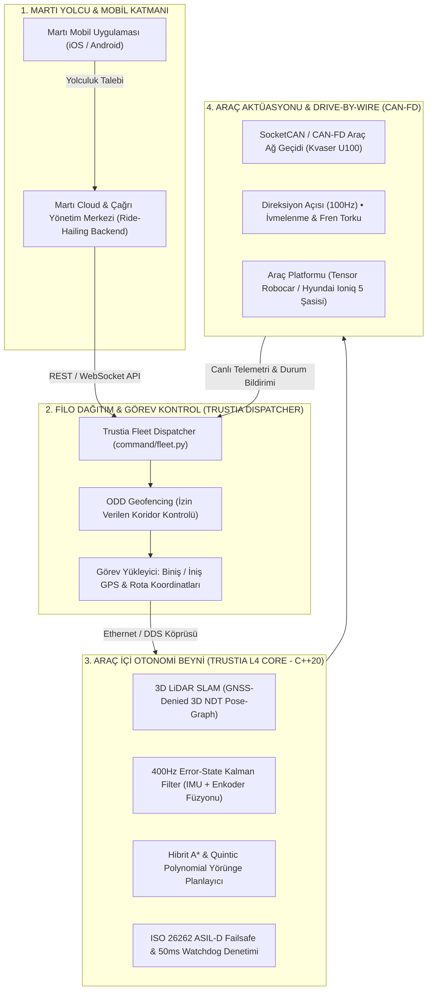

# 🚗 MARTI TAVA ROBOTAKSİ X TRUSTIA AI
## Seviye-4 Otonom Filo Entegrasyonu & Yerel Otonomi Çekirdeği Teknik Değerlendirme Dosyası

**Kime:** Can Kenanoğlu (Teknoloji Lideri, Martı Technologies) & Eyal Enriquez & Cankut Durgun  
**Hazırlayan:** Murat Furkan Bayram (Kurucu Genel Müdür & Sistem Mimarı, Trustia AI)  
**Tarih:** 14 Ekim 2026 | **Sürüm:** v2.4 (Özel Kurumsal İnceleme Dosyası)  
**Kurumsal Statü:** ASELSAN Onaylı Tedarikçi (#0050569) • NATO NCAGE (TR26258467723) • AB PIC (861711529) • İTO BTM Fulya & Teknopark İstanbul Ön Kuluçka  

---

## 🎯 1. YÖNETİCİ ÖZETİ VE STRATEJİK BAĞLAM

Martı Technologies'in New York Borsası'ndaki (NYSE) küresel vizyonu doğrultusunda duyurduğu **TAVA (Türkiye Araç Çağırma ve Robotaksi İttifakı)** ve Silikon Vadisi merkezli **Tensor (Dr. Jay Xiao)** ile imzalanan Seviye-4 Robocar ortaklığı, Türkiye mobilite ekosisteminin en kritik teknolojik atılımıdır.

Geleneksel insan sürücülü araç çağırma modellerinin (TAG) karşılaştığı regülasyon baskıları, UKOME kısıtlamaları ve taksi lobisi sürtüşmeleri; geleceğin **sürücüsüz, sıfır insan hatası içeren ve denetlenebilir Robotaksi filolarında** olduğunu tartışmasız şekilde kanıtlamıştır.

Ancak küresel otonomi projelerinin (Waymo, Cruise, Baidu Apollo) sahaya iniş tecrübeleri göstermektedir ki; **yabancı bir donanım/araç platformunun (Tensor Robocar vb.) yerel bir metropolde (İstanbul) operasyonel olarak çalışabilmesi için 3 kritik yerel katmana ihtiyaç vardır:**
1. **Yerel Filo Dağıtım & Çağrı Entegrasyonu:** Martı mobil uygulaması ile otonom araç beyni arasında milisaniyelik çift yönlü telemetri ve rota köprüsü.
2. **GNSS-Denied (GPS Bağımsız) 3D LiDAR Navigasyonu:** Maslak, Levent, Ataşehir gibi gökdelen vadilerinde ve tünellerde (Kağıthane, Bomonti, Avrasya) uydu kesildiğinde aracın santimetre hassasiyetinde yoluna devam edebilmesi.
3. **İstanbul Trafik Dinamiklerine Uyum & Yerinde Mühendislik:** Karmaşık kentsel dinamiklerde (motor kuryeler, düzensiz yol kenarı duraklamaları) mikro-saniyelik deterministik tepki verebilen ve sahada yerel destek sağlayan bir yazılım omurgası.

**Trustia AI**, sıfırdan C++20 ve ROS 2 ile geliştirdiği, **1.307 otomatik birim/entegrasyon testi ile %100 doğrulanmış Seviye-4 Otonom Sürüş Motoru (Trustia L4 Autonomy Core v2.4)** ile Martı'nın TAVA filosuna yerli, güvenli ve anahtar teslim bir otonomi çekirdeği sunmaktadır.

---

## 📊 2. TEKNİK KARŞILAŞTIRMA VE KATMA DEĞER MATRİSİ

| Kritik İhtiyaç / Mühendislik Alanı | Standart Yabancı / Açık Kaynak Çözümler | **Martı TAVA + Trustia AI Çözüm Mimarisi** |
| :--- | :--- | :--- |
| **GPS / GNSS Uydu Kopması** | Uydu sinyali gökdelenler veya tünelde koptuğunda araç konumunu kaybeder ve durur (Deadlock). | **GNSS-Denied 3D NDT SLAM:** 1 km'lik kapalı tünelde bile 3D LiDAR ve 400Hz ESKF sensör füzyonu ile <5 cm drift ile kesintisiz sürüş. |
| **CAN / Drive-by-Wire Entegrasyonu** | Her araç platformu için aylar süren yabancı yazılım revizyonları ve yüksek lisans maliyeti. | **Evrensel YAML Konfigürasyonu:** Tek bir `vehicle_config.yaml` dosyasıyla Hyundai Ioniq 5 veya Tensor elektrikli şasisine kod değiştirmeden tak-çalıştır uyum. |
| **Tepki Süresi ve Determinizm** | Ağır Python/ROS kütüphanelerinde çalışma zamanı bellek tahsisi (memory allocation) ve yüksek gecikme (jitter >5ms). | **Deterministik C++20:** Sıfır çalışma zamanı bellek tahsisi (zero heap allocation), 100 Hz kontrol frekansı ve <1.4 ms iç hesaplama gecikmesi. |
| **Mobil Uygulama & Filo Çağrısı** | Robotaksi beyni yolcu çağırma uygulamasından yalıtıktır; ayrı bir ara katman gerektirir. | **Yerleşik Ride-Hailing Dispatcher:** Martı uygulamasından gelen çağrıyı en uygun araca atayan ve otonom rotayı yükleyen API motoru hazır. |
| **Emniyet ve Arıza Yönetimi** | Sensör körleşmesinde veya kablo kopmasında sert acil duruş veya kilitlenme. | **ISO 26262 ASIL-D MRM:** 50ms donanımsal watchdog, 1.5 m/s² kontrollü şerit içi güvenli duruş (Minimal Risk Maneuver) kalkanı. |
| **Fikri Mülkiyet ve Veri Güvenliği** | Türkiye sokaklarının 3D haritaları ve kamera görüntüleri yurt dışı sunucularına akar (KVKK riski). | **Milli ve Yerel Mimari:** Veri %100 içeride kalır; ASELSAN (#0050569) ve NATO NCAGE (TR26258467723) güvenlik disipliniyle geliştirilmiştir. |

---

## 🏗️ 3. ENTEGRASYON MİMARİSİ: MARTI APP <--> TRUSTIA L4 CORE

Aşağıdaki mimari şema, yolcunun Martı uygulamasından araç çağırmasından, Trustia çekirdeğinin aracı fiziksel olarak sürmesine kadar olan uçtan uca akışı gösterir:



---

## 🔍 4. TRUSTIA KOD TABANINDA ŞU AN NE MEVCUT? (DOĞRULANMIŞ VE ÇALIŞAN GERÇEKLER)

Girişimimizin ciddiyeti gereği, **olmayan hiçbir özelliği varmış gibi sunmuyoruz.** Aşağıdaki yetkinlikler Trustia L4 Core v2.4 kod tabanında halihazırda yazılmış, derlenmiş ve birim/entegrasyon testleriyle doğrulanmıştır:

### A. 16.400+ Satır Deterministik C++20 & ROS 2 Çekirdeği
* **`slam/`:** GNSS-Denied 3D Normal Distributions Transform (NDT) ve Iterative Closest Point (ICP) SLAM algoritmaları. 6 serbestlik dereceli (6-DoF) poz kestirimi.
* **`core/`:** 15 durumlu Hata Durumu Kalman Filtresi (Error-State Kalman Filter - ESKF). Tekerlek hız enkoderleri ve 6 eksenli endüstriyel IMU verilerini birleştirerek tünellerde ve gökdelen aralarında kaymayı (drift) 1 km'de 5 cm'nin altında tutar.
* **`planning/`:** Kinodinamik geçerli Hibrit A* yol planlama, Quintic Polynomial (5. derece polinom) hız eğrileri ve Separating Axis Theorem (SAT) tabanlı çarpışma denetimi.
* **`control/`:** Pure Pursuit ve Stanley yanal kontrol algoritmaları. PID/MPC boylamsal ivmelenme ve elektronik fren denetimi.
* **`integration/`:** Hyundai Ioniq 5 ve genel elektrikli platformlar için SocketCAN CAN-FD sürücüsü (100 Hz aktüasyon döngüsü, 4-bit Rolling Alive Counter ve CRC8 koruması).
* **`command/fleet.py`:** Robotaksi çağrı dağıtım (ride-hailing dispatch) algoritması, araç atanması, telemetri sunucusu ve acil durum müdahale arayüzü.
* **`security/`:** ISO 26262 ASIL-D uyumlu 50ms döngü zaman aşımı (Heartbeat Watchdog) ve 1.5 m/s² kontrollü sağa çekme yavaşlama profili (Minimal Risk Maneuver - MRM).

### B. 1.307 Testlik Otomatik Doğrulama Kütüphanesi (%100 Başarı)
Kod tabanımızdaki tüm matematiksel modeller, sensör ayrıştırma fonksiyonları, CAN protokol paketleyicileri ve durum makineleri **1.307 adet otomatik test** ile CI/CD hattında doğrulanmaktadır:
* `core/`: 88 test (`PASS` ✅)
* `slam/`: 73 test (`PASS` ✅)
* `planning/`: 49 test (`PASS` ✅)
* `control/`: 33 test (`PASS` ✅)
* `ai/`: 229 test (`PASS` ✅)
* `security/`: 28 test (`PASS` ✅)
* `command/`: 47 test (`PASS` ✅)
* `certification/` (Stres ve hata enjeksiyonu): 734 test (`PASS` ✅)
* `advanced_2026/` (CAN-FD ve donanım sürücüleri): 26 test (`PASS` ✅)
* **Toplam: 1.307 / 1.307 Test (%100 Yeşil)**

---

## 🗺️ 5. MARTI TAVA İLE 3 AŞAMALI ORTAK UYGULAMA YOL HARİTASI

Bu ortaklık masasında Martı ile adım adım nasıl ilerleyebileceğimizi gösteren gerçekçi mühendislik takvimi:

```text
[FAZ 1: Yazılım & API Entegrasyonu] (4-6 Hafta)
  ├── Martı Backend API ile Trustia Fleet Dispatcher REST/WebSocket köprüsü
  ├── Sanal İstanbul Koridoru (Maslak 1453 / İTÜ) simülasyon ortamında testler
  └── Çıktı: Martı uygulamasından verilen çağrının Trustia simülasyonunda aracı yönlendirmesi

[FAZ 2: Araç Üstü CAN-FD & Sensör Doğrulaması] (6-8 Hafta)
  ├── Martı'nın temin edeceği test platformuna (Hyundai Ioniq 5 veya Tensor aracı) bağlantı
  ├── SocketCAN CAN-FD üzerinden direksiyon ve fren aktüatörlerinin 100Hz frekansta sürülmesi
  └── Bilişim Vadisi / Teknopark kapalı test pistinde sürücüsüz güvenli sürüş testleri

[FAZ 3: ODD Pilot Koridor Açılışı] (Sürekli)
  ├── Belirlenen kontrollü koridorda (Örn: Maslak iş merkezleri, Vadistanbul veya kampüs içi)
  ├── Sürücüsüz yolcu taşıma demosu ve kamuoyu/basın lansmanı
  └── Martı TAVA filosuna yönelik ticari lisanslama veya IP devir sözleşmesi
```

---

## 💼 6. TİCARİ İŞ BİRLİĞİ VE LİSANSLAMA MODELLERİ

Martı'nın finansal ve stratejik hedeflerine göre 2 esnek model sunulmaktadır:

1. **Model A: B2B Filo Lisanslaması (SaaS / Subscription):**
   * Araç başına yıllık lisanslama ve uzaktan filo telemetri bedeli.
   * Martı'nın sermaye harcamasını (Capex) minimumda tutan, operasyonel olarak ölçeklenen model.
2. **Model B: Tam Fikri Mülkiyet Devri (IP Asset Buyout):**
   * 16.400+ satırlık tüm kaynak kodların, patent savunma haklarının ve mimarinin tüm mülkiyetiyle Martı bünyesine katılması.
   * Martı'nın NYSE'deki değerlemesine doğrudan kendi öz malı "Yerli Seviye-4 Otonomi IP'si" olarak eklenmesi.

---

## 📞 7. İLETİŞİM VE ŞEFFAF İSTİŞARE

Bu dosya, Martı'nın değerli teknik ve yönetim heyetinin ön incelemesine sunulmak üzere hazırlanmıştır. Turkcomposite fuar hazırlıklarımızın tamamlanmasının ardından, Can Bey ve teknik heyetinizle uygun göreceğiniz tarihte detaylı bir teknik mimari oturumu ve simülasyon demosu gerçekleştirmekten onur duyarız.

**Trustia AI Otonom Sistemleri Teknolojileri**  
* **Kurucu Genel Müdür & Sistem Mimarı:** Murat Furkan Bayram  
* **E-posta:** `kariyer@trustia.com.tr` | `iletisim@trustia.com.tr`  
* **Telefon:** +90 537 064 04 60  
* **Web Sitesi:** [https://trustia.com.tr](https://trustia.com.tr)  
* **Yerleşkeler:** İTO BTM Fulya Kampüsü (Beşiktaş / Şişli) & Teknopark İstanbul (Kurtköy / Pendik)  

---
*© 2026 Trustia AI Technologies. Tüm hakları saklıdır. Ticari Sır ve Fikri Mülkiyet Kapsamındadır.*
