# 🚗 TRUSTIA AI — Seviye-4 Otonom Sürüş & Robotaksi Yazılım Çekirdeği (v2.4)


[-brightgreen.svg?logo=pytest&logoColor=white)](https://github.com/Trustia/Trustia)
[](https://github.com/Trustia/Trustia)
[](https://python.org)
[](https://nextjs.org)
[-blue.svg)](https://trustia.com.tr)
[](https://trustia.com.tr)
[](https://trustia.com.tr)
[](https://aselsan.com.tr)
[](https://trustia.com.tr)
[](https://trustia.com.tr)

> **Ticari yolcu robotaksileri, fabrika/depo içi otonom lojistik araçları (AMR/AGV), otonom kampüs servisleri ve savunma sanayii insansız kara araçları (İKA) için sıfırdan C++20, ROS 2 ve Python ile geliştirilmiş; donanımdan bağımsız, GNSS-Denied 3D LiDAR SLAM tabanlı Seviye-4 Otonom Sürüş Motoru.**  
> **1.307 adet otomatik birim ve entegrasyon testi ile %100 doğrulanmış, yerel CAN-FD araç kontrol ağ geçitlerine sahip, harici kapalı kutu bağımlılığı bulunmayan kurumsal B2B otonomi yığını.**

---

## 🏛️ 1. Resmi Kurumsal Akreditasyonlar & Ekosistem Kayıtları

Trustia AI, ulusal ve uluslararası savunma, sanayi ve derin teknoloji ekosistemlerinde resmi tescillere sahiptir:

| Kurum / Organizasyon | Bölge | Tescil / Tanım & Statü |
| :--- | :--- | :--- |
| 🛡️ **ASELSAN A.Ş.** | Ankara, TR | **Onaylı Tedarikçi Kütüğü (Firma Kodu: `#0050569`)** |
| 🎖️ **NATO / Milli Savunma Bakanlığı** | Brüksel / Ankara | **NATO Ticari ve Devlet Kuruluşu Kodu (NCAGE: `TR26258467723`)** |
| 🇹🇷 **STM Savunma Teknolojileri** | Ankara, TR | **Aday Tedarikçi Kaydı** (Otonom ve Yapay Zeka Sistemleri) |
| 🇪🇺 **Avrupa Komisyonu (European Commission)** | Brüksel, AB | **Resmi AB Katılımcı Kimlik Kodu (PIC: `861711529`)** |
| 🇪🇺 **EIT Urban Mobility** | Barselona, AB | **Kayıtlı Mobilite Partner ID (`CUS15554`)** |
| 🚀 **Teknopark İstanbul (Cube Incubation)** | İstanbul, TR | **Ön Kuluçka Girişimi & HASAT 2026 Hızlandırma Programı** |
| 🏛️ **İTO BTM (Bilgiyi Ticarileştirme Merkezi)** | İstanbul, TR | **Fulya Derin Teknoloji Kampüsü Yerleşik Girişimi** |
| 🎓 **YTÜ Yıldız Teknopark** | İstanbul, TR | **Kuluçka ve Ekosistem Başvurusu** |
| 🛡️ **Open Invention Network (OIN)** | Durham, ABD | **İkili Patent Savunma ve Karşılıklı Çapraz Lisans Anlaşması** |

---

## 🏗️ 2. Tam Kapsamlı Seviye-4 Sistem Mimarisi

Uluslararası **SAE J3016 Seviye-4** ve **ISO 26262 ASIL-D** otomotiv standartlarına tam uyumlu 8 kritik alt sistem katmanı:

```mermaid
flowchart TD
    subgraph Katman1 ["1. ÇOKLU SENSÖR VE VERİ ALIM KATMANI (SENSING)"]
        LIDAR["3D LiDAR (Ouster OS2-128 / Livox Mid-360 Raw UDP)"]
        CAM["GMSL2 Otomotiv Kameraları (Sony IMX390 HDR 120dB)"]
        RADAR["77GHz Uzun Menzilli Radar (Continental ARS408-21)"]
        IMU["Endüstriyel 6-Eksen IMU & Enkoder Telemetrisi"]
    end

    subgraph Katman2 ["2. TRUSTIA L4 OTONOMİ ÇEKİRDEK MOTORU (16.400+ SATIR)"]
        SLAM["GNSS-Denied 3D NDT / ICP Pose-Graph SLAM (Tünel & Şehir İçi)"]
        ESKF["400Hz Hata Durumu Kalman Filtresi (15-State ESKF Füzyonu)"]
        PERCEPT["Zemin Ayrıştırma (RANSAC) & 3D Bounding Box Kümeleme"]
        PREDICT["EKF Dinamik Engel Takibi & 3-5sn Gelecek Yörünge Tahmini"]
        FSM["Hiyerarşik Sonlu Durum Makinesi (Hierarchical FSM & ODD Yönetimi)"]
        PLAN["Kinematik Hibrit A* & Quintic Polynomial Yörünge Planlama"]
        SAFETY["ISO 26262 ASIL-D MRM Güvenli Duruş & 50ms Watchdog Denetimi"]
    end

    subgraph Katman3 ["3. ARAÇ ENTEGRASYONU & DRIVE-BY-WIRE AKTÜASYONU"]
        CAN["Kvaser U100 İzole CAN-FD Ağ Geçidi"]
        STEER["100Hz Yanal Direksiyon Kontrolü (Pure Pursuit / Stanley DBC)"]
        SPEED["50Hz Boylamsal İvmelenme / Elektronik Fren Torku"]
        WATCH["Donanımsal E-Stop & Minimal Risk Manevrası (MRM Kilitlenmesi)"]
    end

    subgraph Katman4 ["4. TİCARİ UYGULAMA VE DAĞITIM ALANLARI"]
        ROBOTAXI["Otonom Yolcu Robotaksisi (Hyundai Ioniq 5 / Kia EV6 / Martı TAVA)"]
        INTRALOGISTICS["Fabrika ve Depo İçi Ağır Yük AGV / AMR Lojistiği"]
        SHUTTLE["Havalimanı, Kampüs ve Kapalı Alan Otonom Ring Servisleri"]
        DEFENSE["Savunma Sanayii Otonom İnsansız Kara Araçları (İKA)"]
    end

    Katman1 --> Katman2
    Katman2 --> Katman3
    Katman3 --> Katman4
```



---

## ⚙️ 3. Evrensel Otonomi & Konfigürasyon Modeli (Universal Autonomy)

Dünyadaki Tier-1 otonomi devlerinde (**Oxa, Apex.ai, Momenta, Waymo**) olduğu gibi, Trustia mimarisinde temel matematiksel fizik formülleri araçtan araca veya kullanım senaryosuna göre **asla değişmez**.

Aynı çekirdek yazılım motoru; hem 50 km/s ile şehir trafiğinde yolcu taşıyan bir **Robotaksiyi**, hem fabrikada 15 km/s ile palet taşıyan bir **Ağır Yük AGV'sini**, hem de havalimanı **Ring Servisini** yönetir.

### Tek Konfigürasyon Dosyası ile Tüm Araçlara Uyum (`config/vehicle_config.yaml`):
Alıcı firmanın entegrasyon mühendisi koda dokunmadan, sadece aracın fiziksel ölçülerini bu dosyaya tanımlar:

```yaml
# ==============================================================================
# TRUSTIA L4 OTONOMİ MOTORU - ARAÇ VE GÖREV KONFİGÜRASYONU
# ==============================================================================
vehicle:
  name: "Hyundai_Ioniq_5_Robotaxi"   # veya "Fabrika_AGV_Platformu"
  wheelbase_m: 3.00                  # Ön-arka dingil mesafesi (metre)
  track_width_m: 1.63                # Tekerlek iz genişliği (metre)
  max_steering_angle_deg: 40.0        # Maksimum direksiyon dönüş açısı
  max_speed_kmh: 50.0                # İzin verilen maksimum otonom sürüş hızı
  min_turning_radius_m: 5.2          # Minimum dönüş yarıçapı
  can_interface: "can0"              # CAN-FD SocketCAN arayüzü
  can_bitrate: 500000                # Standart CAN hızı
  can_data_bitrate: 2000000           # CAN-FD veri hızı (2 Mbps)

control:
  lateral_controller: "pure_pursuit" # Stanley veya Pure Pursuit
  lookahead_distance_min_m: 2.5
  lookahead_distance_max_m: 12.0
  lookahead_ratio: 0.45

safety:
  watchdog_timeout_ms: 50            # 50ms mesaj kesintisinde acil duruş
  mrm_deceleration_mps2: 1.5         # Güvenli sağa çekme yavaşlama ivmesi
  collision_safety_margin_m: 0.8     # Güvenlik tampon payı
```

Yazılım başlatıldığı anda bu parametreleri yükler; Ackermann dönüş geometrisi, Pure Pursuit yanal kontrolü ve fren-gaz profilleri **otomatik olarak o araca göre çalışır**.

---

## 🏎️ 4. Hyundai Ioniq 5 Seviye-4 Referans Donanım Mimarisi

| Alt Sistem Bileşeni | Model ve Donanım Spesifikasyonu | Entegrasyon ve Görev Tanımı |
| :--- | :--- | :--- |
| **Merkezi Yapay Zeka Bilgisayarı** | **NVIDIA Jetson AGX Orin 64GB** | 275 TOPS INT8 • 2048-Çekirdek Ampere GPU • Gerçek Zamanlı Linux |
| **Birincil 3D SLAM LiDAR** | **Ouster OS2-128 Rev 7** | 128 Kanal • 240m Menzil • Saniyede 2.62M Nokta • Tavan Montajı |
| **Kör Nokta & Yakın Alan LiDAR** | **2x Livox Mid-360** | 360°x59° Görüş Alanı • 40m Menzil • Ön ve Arka Tampon Podları |
| **360° Görsel Çevre Kameraları** | **4x Sony IMX390 GMSL2** | 120 dB Geniş Dinamik Aralık (HDR) • IP67 Otomotiv Standart |
| **Her Hava Koşulu Radarı** | **Continental ARS 408-21 (77GHz)** | 250m Uzun Menzilli Tespit • Sis, Yoğun Yağmur ve Gece Görüşü |
| **Yüksek Hassasiyetli RTK GNSS/INS** | **Septentrio AsteRx-m3 Pro** | Çift Antenli Yön Tayini • 1 cm Hassasiyet • 400Hz ESKF Füzyon |
| **Drive-by-Wire Ağ Geçidi** | **Kvaser U100 İzole CAN-FD** | Hyundai E-GMP Veri Yolu • Direksiyon, Gaz, Fren, Vites Kontrolü |
| **Donanımsal Güvenlik (ASIL-D)** | **Hardware Watchdog & Dual Relay** | 5ms İnsan Devralması (Takeover) • 200ms Dead-Man Güvenliği |

---

## 📊 5. 1.307 Testlik Otomatik Doğrulama Kütüphanesi

Trustia kod tabanındaki tüm matematiksel modeller, algılama filtreleri, yörünge planlayıcılar ve CAN-FD iletişim döngüleri, **1.307 adet otomatik test** ile sürekli doğrulanmaktadır:

| Modül / Alt Sistem | Test Kapsamı ve Odak Noktası | Geçen Test Sayısı | Durum |
| :--- | :--- | :---: | :---: |
| **`core/` & Matematiksel Temeller** | Vektör cebri, dönüşüm matrisleri, telemetri akışı (`system6`) | **88 / 88** | `GEÇTİ` ✅ |
| **`slam/` & 3D Konumlandırma** | 3D NDT LiDAR SLAM, 400Hz ESKF, pose-graph optimizasyonu (`system1`) | **73 / 73** | `GEÇTİ` ✅ |
| **`planning/` & Kinematik Planlama** | Hibrit A* Ackermann planlayıcı, DWA, dinamik maliyet haritası (`system1, 2`) | **49 / 49** | `GEÇTİ` ✅ |
| **`control/` & Drive-by-Wire** | Pure Pursuit, Stanley yanal takip, SocketCAN CAN-FD sürücüsü (`system1, 8`) | **33 / 33** | `GEÇTİ` ✅ |
| **`ai/` & Çevresel Algılama** | Çoklu mod engel tespiti, zemin segmentasyonu, 3D kümeleme (`system9`) | **229 / 229** | `GEÇTİ` ✅ |
| **`security/` & Emniyet Protokolleri** | Otomotiv siber güvenlik, telemetri şifreleme, ASIL-D MRM E-Stop (`system5`) | **28 / 28** | `GEÇTİ` ✅ |
| **`command/` & Filo Yönetimi** | Robotaksi çağrı dağıtıcı, filo rota motoru, teleoperasyon (`system34`) | **47 / 47** | `GEÇTİ` ✅ |
| **`certification/` & Senaryo Matrisi** | %100 Determinizm, stres testleri, hata enjeksiyon senaryoları (`system7`) | **734 / 734** | `GEÇTİ` ✅ |
| **`advanced_2026/` & L4 Donanım Katmanı** | Hyundai Ioniq 5 CAN-FD DBC, Jetson Orin sürücüleri (`system10`) | **26 / 26** | `GEÇTİ` ✅ |
| **TOPLAM DOĞRULANMIŞ TEST SETİ** | **Eksiksiz Tam Seviye-4 Otonom Sistem Mimarisi** | **1.307 / 1.307** | **`%100 BAŞARILI`** 🚀 |

---

## 🔒 6. Enterprise Autonomy SDK & Fikri Mülkiyet (IP) Koruması

Trustia, müşterilere (OEM'ler, filo operatörleri ve entegratörler) **kapalı kutu (black-box) ikili bayt kod** formatında teslim edilir:

1. **Sıfır Açık Kaynak Kodu Politikası:** Çekirdeğin içindeki tüm 69 modül derlenmiş `.pyc` biçiminde paketlenir; müşteriye okunabilir açık metin `.py` kaynak kodu verilmez.
2. **Kriptografik Donanım Kilidi (Hardware-Locked):** Her yazılım paketi yalnızca hedef bilgisayarın anakart UUID'si ve MAC adresine lisanslanır. Başka bir araca veya bilgisayara kopyalandığında çalışmaz.
3. **Temiz ve Zarif Python API'si:**
   ```python
   from trustia import AutonomyCore

   # Araç konfigürasyonu ile otonomi motorunu başlat
   car = AutonomyCore(config_file="config/vehicle_config.yaml")
   car.start()
   ```

---

## 📁 7. Proje Dizin Yapısı

```text
Trustia/
├── 📂 .github/workflows/                 <-- Otomatik CI/CD ve Test Doğrulama Pipeline'ı
│   ├── 📜 deploy.yml                     <-- Canlı Dağıtım İş Akışı
│   └── 📜 ci.yml                         <-- 1.307 Testlik Doğrulama Pipeline'ı
├── 📂 01_Trustia_Otonom_Yazilim_Core/    <-- 16.400+ Satır Seviye-4 Çekirdek Kod & Testler
│   ├── 📂 ai/                            <-- 3D Engel Tespiti ve Çevresel Algılama
│   ├── 📂 command/                       <-- Robotaksi Filo Çağrı Motoru ve Teleoperasyon
│   ├── 📂 control/                       <-- Pure Pursuit, Stanley ve CAN-FD Araç Aktüasyonu
│   ├── 📂 core/                          <-- Durum Tahmincileri, Lisanslama ve SDK Çekirdeği
│   ├── 📂 integration/                   <-- CAN-Bus J1939 ve ROS 2 Ağ Geçidi Protokolleri
│   ├── 📂 planning/                      <-- Hibrit A* Ackermann Yörünge Planlayıcıları
│   ├── 📂 security/                      <-- AES-256 Şifreleme, Watchdog ve ASIL-D MRM Motoru
│   ├── 📂 slam/                          <-- GNSS-Denied 3D NDT SLAM ve LiDAR Odometrisi
│   ├── 📂 tests/                         <-- 1.307 Otomatik Birim ve Entegrasyon Testi
│   ├── 📂 tools/                         <-- Enterprise SDK Derleme ve Paketleme Araçları
│   └── 📜 trustia_cli.py                 <-- CLI Yönetim ve Test Konsolu
├── 📂 02_Trustia_Web_Platformu/          <-- Next.js 16 Web Platformu ve 3D Gösterge Paneli
│   └── 📂 website/                       <-- Web Kaynak Kodları, Bileşenler ve WebGL Konsolu
├── 📂 Kurumsal/                          <-- Resmi Belgeler, Sunumlar ve Medya Arşivi
│   ├── 📂 Belgeler/                      <-- Tescil Belgeleri ve Kurumsal Sertifikalar
│   ├── 📂 Sunumlar/                      <-- Yatırımcı Pitch Deck'leri, BOM ve Mühendislik Planları
│   └── 📂 Medya/                         <-- Yüksek Çözünürlüklü Logolar, Araç Görselleri ve Videolar
├── 📜 .gitignore                         <-- Git Dışlama Kuralları
├── 📜 AGENTS.md                          <-- Mühendislik ve Sistem Çalışma Kuralları
└── 📜 README.md                          <-- Ana Kurumsal Tanıtım ve Mimari Dokümantasyonu
```

---

## 💻 8. Test ve Doğrulama Çalıştırma Talimatları

Yazılım çekirdeğindeki tüm testleri yerel ortamda çalıştırmak için:

```bash
# 1. Otonom yazılım dizinine geçiş yapın
cd 01_Trustia_Otonom_Yazilim_Core

# 2. 1.307 adet otomatik testi çalıştırın
pytest tests/ -q --tb=short

# 3. Sistem denetim raporunu görüntüleyin
python trustia_cli.py audit
```

---

## 🤝 9. Kurumsal İletişim & İş Birlikleri

Otonom filo entegrasyonu, B2B lisanslama, teknopark ve kurumsal iş birlikleri doğrudan kurucu tarafından yürütülmektedir:

* **Kurucu & Sistem Mimarı:** Murat Furkan Bayram
* **Resmi Web Sitesi:** [https://trustia.com.tr](https://trustia.com.tr)
* **Kurumsal E-Posta:** [iletisim@trustia.com.tr](mailto:iletisim@trustia.com.tr) | [kariyer@trustia.com.tr](mailto:kariyer@trustia.com.tr)
* **Telefon:** +90 537 064 0460
* **LinkedIn:** [linkedin.com/in/trustia](https://www.linkedin.com/in/trustia)
* **Yerleşkeler:** İTO BTM (Fulya Kampüsü, Beşiktaş / İstanbul) & Teknopark İstanbul (Kurtköy / Pendik)

---

*© 2026 Trustia AI. Tüm hakları saklıdır. Seviye-4 Otonom Sistemler Mühendislik Dokümantasyonu.*
