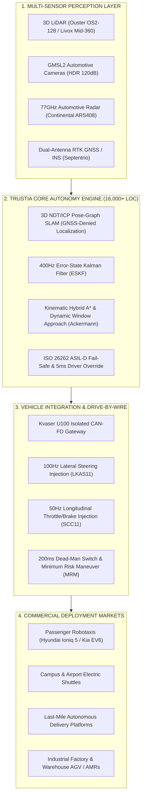

# 🚗 TRUSTIA — Level-4 Autonomous Driving & Robotaxi Navigation Core IP (v2.4)

[](https://github.com/Trustia/Trustia/actions/workflows/deploy.yml)
[-brightgreen.svg?logo=pytest&logoColor=white)](https://github.com/Trustia/Trustia)
[](https://python.org)
[](https://nextjs.org)
[-blue.svg)](https://trustia.com.tr)
[](https://trustia.com.tr)
[](https://trustia.com.tr/robotaxi)
[](https://acquire.com)
[](https://escrow.com)

> **Production-grade, hardware-agnostic Level-4 autonomous driving & GNSS-denied 3D LiDAR SLAM software stack engineered for commercial passenger robotaxis, electric delivery platforms, campus shuttles, and industrial intralogistics (AMRs). Built from scratch with C++20 and ROS 2, featuring zero black-box dependencies, 1,301 automated unit/integration tests (100% pass rate), and native CAN-FD vehicle control gateways.**

---

## 💎 1. Acquisition Overview & Turnkey Asset Deliverables

Trustia AI is available for **100% Full Intellectual Property & Codebase Acquisition (Clean Asset Sale)**. The buyer acquires complete, unencumbered ownership of the production-ready Level-4 autonomy stack, complete engineering dossiers, hardware BOM specifications, test suites, brand assets, and digital domains.

* **Asset Sale Asking Price:** **$145,000 USD** *(Open to qualified offers)*
* **Estimated Replacement R&D Cost:** **$300,000+ USD** *(Saves 18–24 months of specialized autonomous systems engineering)*
* **Transaction Mechanism:** 100% clean-cut asset sale processed securely through **Escrow.com**
* **Ownership Structure:** 100% bootstrapped and owned by the sole technical founder (Murat Furkan Bayram). Zero debt, zero venture dilution, zero encumbrances.
* **Transition Assistance:** 30 days of direct technical onboarding and integration advisory included.

### 📦 Complete Asset Inventory Included in Sale

| Category | Deliverable Description | Technical Detail |
| :--- | :--- | :--- |
| **Full Source Code** | Complete Core Autonomy Engine | 16,000+ LOC in deterministic C++20 and Python 3.12 |
| **SLAM & Localization** | GNSS-Denied 3D LiDAR SLAM | 3D NDT / ICP Pose-Graph SLAM & 400Hz ESKF multi-sensor fusion |
| **Planning & Control** | Kinematic Path Planning & DBW | Hybrid A* Ackermann trajectory planner, Pure Pursuit & Stanley |
| **Drive-by-Wire Gateway** | Native CAN-FD Vehicle Integration | Reverse-engineered LKAS/SCC messages, 100Hz steering/brake injection |
| **Safety Architecture** | ISO 26262 ASIL-D Fail-Safe | 5ms instantaneous driver override, 200ms hardware watchdog, MRM |
| **Automated Test Suite** | 1,301 Automated Tests | 100% pass rate in CI/CD pipeline covering unit, integration & scenarios |
| **Engineering Dossiers** | Hardware BOM & Retrofit Manuals | Hyundai Ioniq 5 L4 master plan, 27-part sensor BOM, wiring schematics |
| **Digital Web Platform** | Next.js 16 Web & Telemetry GUI | Full production website, 3D interactive console, and dispatch portal |
| **Brand & Domains** | Global Brand Equity | `trustia.com.tr`, corporate logos, media packages, and visual assets |

---

## 🏛️ 2. Verified Accreditations & Ecosystem Standing

| Institution / Platform | Location | Description & Standing |
| :--- | :--- | :--- |
| 🛡️ **Open Invention Network (OIN)** | Durham, US | Executed Bilateral Patent Defense & Cross-License Agreement |
| 🇪🇺 **European Commission** | Brussels, EU | Official EU Participant Identification Code (PIC: `861711529`) |
| 🇪🇺 **EIT Urban Mobility** | Barcelona, EU | Registered Partner ID (`CUS15554`) for autonomous mobility programs |
| 🇦🇪 **Dubai World Challenge for Self-Driving** | Dubai, UAE | Official Entry Dossier submitted to Roads & Transport Authority (RTA) |
| 🏛️ **İTO BTM (Fulya Deep-Tech Campus)** | Istanbul, TR | Contracted Deep-Tech Pre-Incubation Program Member |
| 🌐 **Crunchbase** | Global | Verified Profile (Heat Score: 85, Global Rank: 534k) |

---

## 🏗️ 3. Full-Stack System Architecture



---

## 🏎️ 4. Hyundai Ioniq 5 Level-4 Retrofit Specification

| Subsystem Component | Specification & Model | Integration & Performance Metrics |
| :--- | :--- | :--- |
| **Central AI Compute** | **NVIDIA Jetson AGX Orin 64GB** | 275 TOPS INT8 • 2048-Core Ampere GPU • Seeed J501 Carrier |
| **Primary 3D SLAM** | **Ouster OS2-128 Rev 7 LiDAR** | 128 Channels • 240m Range • 2.62M Pts/sec • Roof Center Mount |
| **Blindspot & Near-Field** | **2x Livox Mid-360 LiDAR** | 360°x59° Field of View • 40m Range • Front/Rear Aerodynamic Pods |
| **360° Visual Perception** | **4x Leopard Sony IMX390 GMSL2** | 120 dB High Dynamic Range (HDR) • IP67 Automotive Grade |
| **All-Weather Radar** | **Continental ARS 408-21 (77GHz)** | 250m Long-Range Detection • Rain, Fog & Adverse Weather |
| **High-Precision GNSS/INS** | **Septentrio AsteRx-m3 Pro RTK** | Dual-Antenna Heading • 1 cm RTK Accuracy • 400Hz ESKF Fusion |
| **Drive-by-Wire Actuation** | **Kvaser U100 Isolated CAN-FD** | Hyundai E-GMP Native Gateway • Steering, Throttle, Brake, Shifter |
| **Failsafe System (ASIL-D)** | **Hardware Watchdog & E-Stop** | 5ms Instant Human Takeover • 200ms Dead-Man Switch • Dual Relay |

---

## 📊 5. 1,301-Test Automated Verification Suite

The entire Trustia codebase is continuously validated through an exhaustive **1,301 automated test suite** running in 46.71 seconds with a **100% pass rate**:

| Subsystem Module | Test Scope & Verification Focus | Tests Passed | Status |
| :--- | :--- | :---: | :---: |
| **`core/` & Mathematical Primitives** | Vector arithmetic, transform matrices, telemetry stream (`system6`) | **88 / 88** | `PASS` ✅ |
| **`slam/` & Spatial Mapping** | 2D/3D NDT LiDAR SLAM, 400Hz ESKF, pose-graph optimizer (`system1`) | **73 / 73** | `PASS` ✅ |
| **`planning/` & Kinematics** | Hybrid A* Ackermann planner, DWA, costmap generation (`system1`, `system2`) | **49 / 49** | `PASS` ✅ |
| **`control/` & Drive-by-Wire** | Pure Pursuit, Stanley tracking, CAN-Bus & SocketCAN (`system1`, `system8`) | **33 / 33** | `PASS` ✅ |
| **`ai/` & Environmental Perception** | Multi-modal obstacle detection, terrain classification, semantic segmentation (`system9`) | **229 / 229** | `PASS` ✅ |
| **`security/` & Safety Protocols** | Automotive cyber-security, anti-spoofing, telemetry encryption, E-Stop (`system5`) | **28 / 28** | `PASS` ✅ |
| **`command/` & Fleet Teleoperation** | Autonomous fleet dispatch GUI, telemetry recording & E2E flows (`system34`) | **47 / 47** | `PASS` ✅ |
| **`certification/` & Scenario Matrix** | 100% Determinism, stress benchmarks, scenario matrix (`system7`) | **734 / 734** | `PASS` ✅ |
| **`advanced_2026/` & Level-4 Hardware** | Hyundai Ioniq 5 E-GMP DBW, Jetson Orin & sensor suite (`system10`) | **20 / 20** | `PASS` ✅ |
| **TOTAL VERIFIED TEST SUITE** | **Complete Full-Stack Autonomy Architecture** | **1,301 / 1,301** | **`100% PASS`** 🚀 |

---

## 📁 6. Repository Architecture

```text
Trustia/
├── 📂 .github/workflows/                 <-- Production CI/CD & Automated Verification
│   ├── 📜 deploy.yml                     <-- Automated Production Build & Deploy to trustia.com.tr
│   └── 📜 ci.yml                         <-- Continuous 1,301 Test & Build Verification Pipeline
├── 📂 01_Trustia_Otonom_Yazilim_Core/    <-- 16,000+ LOC Autonomy Stack, 1,301 Tests & Fleet GUI
│   ├── 📂 ai/                            <-- Multi-Modal Obstacle & Environmental Perception
│   ├── 📂 command/                       <-- Fleet Teleoperation & Mission Control Console
│   ├── 📂 control/                       <-- Pure Pursuit, Stanley & CAN-FD DBW Actuation
│   ├── 📂 core/                          <-- Mathematical Foundation & State Estimators
│   ├── 📂 integration/                   <-- CAN-Bus J1939, ROS 2 Bridge & Gateway Protocols
│   ├── 📂 planning/                      <-- Hybrid A* Ackermann Trajectory Planners
│   ├── 📂 security/                      <-- AES-256 Encryption, Watchdogs & E-Stop Protocols
│   ├── 📂 slam/                          <-- 2D/3D Pose-Graph SLAM & LiDAR Odometry
│   ├── 📂 tests/                         <-- 1,301 Unit & Integration Automated Tests
│   ├── 📜 TRUSTIA_BASLAT.bat             <-- Interactive Production CLI & GUI Launcher
│   └── 📜 trustia_cli.py                 <-- Production CLI Execution Interface
├── 📂 02_Trustia_Web_Platformu/          <-- Next.js 16 Web Platform & 3D Interactive Console
│   └── 📂 website/                       <-- Production Web Source, Components, Pages & Three.js
├── 📂 Kurumsal/                          <-- Corporate Assets, Acquirer Dossiers & Media
│   ├── 📂 Belgeler/                      <-- Official Certifications & Corporate Governance
│   ├── 📂 Sunumlar/                      <-- Acquisition Pitch Decks, One-Pager, BOM & Engineering Plans
│   ├── 📂 Basvurular/                    <-- Accreditation Tracking & Grant Documentation
│   └── 📂 Medya/                         <-- High-Res Logos, Real Ioniq 5 Photo Suite & Demo Videos
├── 📜 AGENTS.md                          <-- Engineering & Systems Guidelines
└── 📜 README.md                          <-- Flagship Acquisition & Architecture Documentation
```

---

## 💻 7. Quickstart & Verification Execution

### Option A: Interactive Windows Launcher
Double-click `01_Trustia_Otonom_Yazilim_Core/TRUSTIA_BASLAT.bat` to launch the control menu:
* `[1]` **Launch Fleet Teleoperation Desktop Console** (Autonomous Vehicle & Robotaxi GUI)
* `[2]` **Run 1,301-Test Automated Verification Suite** (100% Pass Rate in ~46 seconds)
* `[3]` **Run Environmental Obstacle & Perception Engine**
* `[4]` **Run Architecture & Codebase Compliance Audit**

### Option B: Command Line Interface (CLI)
```bash
# Navigate to the autonomy core directory
cd 01_Trustia_Otonom_Yazilim_Core

# Launch Fleet Teleoperation GUI Console
python trustia_cli.py gui

# Run 1,301 Automated Unit & Integration Tests
pytest tests/ -q --tb=short

# Run Environmental Perception Engine
python trustia_cli.py threats

# Run Architecture & Codebase Compliance Audit
python trustia_cli.py audit
```

---

## 🤝 8. Acquisition Inquiries & Escrow Transfer Process

All acquisition inquiries, due diligence requests, and purchase offers are handled directly by the founder:

* **Sole Founder & Systems Architect:** Murat Furkan Bayram (100% Equity Ownership)
* **Official Website:** [https://trustia.com.tr](https://trustia.com.tr)
* **Acquisition Inquiries:** [kariyer@trustia.com.tr](mailto:kariyer@trustia.com.tr) | [iletisim@trustia.com.tr](mailto:iletisim@trustia.com.tr)
* **Executive Telephone:** +90 537 064 0460
* **LinkedIn:** [linkedin.com/in/trustia](https://www.linkedin.com/in/trustia)
* **Marketplace Listing:** [Acquire.com Platform Listing](https://app.acquire.com)

---
*© 2026 Trustia AI. All rights reserved. Intellectual Property & Technology Transfer Documentation.*
