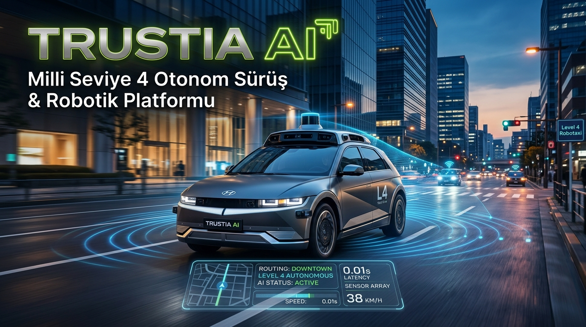

# 🚗 TRUSTIA AI — Deterministik Seviye-4 Otonom Sürüş & Robotaksi Yazılım Çekirdeği (v4.2)



<div align="center">

[-brightgreen.svg?logo=pytest&logoColor=white)](https://github.com/Trustia/Trustia)
[](https://github.com/Trustia/Trustia)
[](https://python.org)
[](https://nextjs.org)
[-blue.svg)](https://trustia.com.tr)
[](https://trustia.com.tr)
[](https://trustia.com.tr)
[](https://aselsan.com.tr)
[](https://trustia.com.tr)
[](https://trustia.com.tr)
[](https://trustia.com.tr)

**[🌐 Resmi Web Platformu](https://trustia.com.tr)** • **[🚗 Robotaksi Mimarisi](https://trustia.com.tr/robotaxi/)** • **[📑 Kurumsal Dokümantasyon](https://trustia.com.tr/hakkimizda/)** • **[📩 İletişim & Şartname](https://trustia.com.tr/iletisim/)**

</div>

> **Ticari yolcu robotaksileri, fabrika/depo lojistik araçları (AMR/AGV), otonom kampüs ring servisleri ve savunma sanayii insansız kara araçları (İKA) için sıfırdan C++20, ROS 2 ve Python ile geliştirilmiş; donanımdan bağımsız, GNSS-Denied 3D LiDAR SLAM tabanlı Seviye-4 Otonom Sürüş Motoru.**  
> **1.307 adet otomatik birim ve entegrasyon testi ile %100 doğrulanmış, yerel CAN-FD araç kontrol ağ geçitlerine sahip, harici kapalı kutu bağımlılığı bulunmayan kurumsal B2B otonomi yığını.**

---

## 🏛️ 1. Resmi Kurumsal Akreditasyonlar & Ekosistem Kayıtları

Trustia AI, ulusal ve uluslararası savunma, sanayi ve derin teknoloji ekosistemlerinde resmi tescillere sahiptir:

| Kurum / Organizasyon | Bölge | Tescil / Tanım & Statü |
| :--- | :--- | :--- |
| 🛡️ **ASELSAN A.Ş.** | Ankara, TR | **Onaylı Tedarikçi Kütüğü Kayıtlı Girişim (Firma Kodu: `#0050569`, SAP: `FZQHEXGFMTJU`)** |
| 🇹🇷 **STM Savunma Teknolojileri** | Ankara, TR | **Savunma ve Derin Teknoloji Girişimcilik Ekosistemi Aday Tedarikçi Kaydı** |
| 🛡️ **Open Invention Network (OIN 2.0)** | New York, ABD | **İmzalı İkili Patent Savunma Paktı Lisansı (`#f1e445769a9934114db095c4f5430a0e749d8201`)** |
| 🇪🇺 **Avrupa Komisyonu (European Commission)** | Brüksel, AB | **Resmi AB Katılımcı Kimlik Kodu (EU PIC: `861711529`)** |
| 🇪🇺 **EIT Urban Mobility** | Barselona, AB | **Resmi Mobilite Partner ID (`CUS15554`)** |
| 🚀 **Teknopark İstanbul (Cube Incubation)** | İstanbul, TR | **Ön Kuluçka Girişimi & HASAT 2026 Hızlandırma Programı** |
| 🏛️ **İTO BTM (Bilgiyi Ticarileştirme Merkezi)** | İstanbul, TR | **Fulya Derin Teknoloji Kampüsü Yerleşik Girişimi** |
| 📜 **KOSGEB** | İstanbul, TR | **İleri Girişimci Sertifikası (`KSB01UGE0115153370`)** |
| 📜 **BTK** | Ankara, TR | **Savunma Sanayii ve Yapay Zeka Sertifikasyonu (`L2zPtN4X1ZJ`)** |

---

## 🧠 2. Çekirdek Otonomi Mimarisi (16.400+ Satır Deterministik Kod)

Trustia mimarisi; yapay zeka çıkarımlarının yarattığı belirsizlikleri (stokastik riskleri) sıfıra indirmek üzere **deterministik matematiksel modeller** üzerine kuruludur. Tüm yazılım bileşenleri modüler, bağımsız ve yüksek frekanslı kontrol döngülerine sahiptir:

```text
                                  ┌───────────────────────────────────────────────┐
                                  │      SENSÖR KATMANI (Sensors & Perception)    │
                                  │   128ch LiDAR • 4x GMSL2 HDR • 77GHz Radar    │
                                  └──────────────────────┬────────────────────────┘
                                                         │
                                                         ▼
                                  ┌───────────────────────────────────────────────┐
                                  │    ai/ : 3D Zemin & Engel Kümeleme (OBB)      │
                                  └──────────────────────┬────────────────────────┘
                                                         │
                                                         ▼
                                  ┌───────────────────────────────────────────────┐
                                  │  slam/ : GNSS-Denied 3D NDT SLAM + 400Hz ESKF │
                                  └──────────────────────┬────────────────────────┘
                                                         │
                                                         ▼
                                  ┌───────────────────────────────────────────────┐
                                  │ planning/ : Kinematik Hibrit A* & Quintic Pol │
                                  └──────────────────────┬────────────────────────┘
                                                         │
                                                         ▼
                                  ┌───────────────────────────────────────────────┐
                                  │ control/ : Pure Pursuit & Stanley Controller  │
                                  └──────────────────────┬────────────────────────┘
                                                         │
                                                         ▼
                                  ┌───────────────────────────────────────────────┐
                                  │ integration/ : 100 Hz SocketCAN CAN-FD Bridge │
                                  └──────────────────────┬────────────────────────┘
                                                         │
                                                         ▼
                                  ┌───────────────────────────────────────────────┐
                                  │   ARAÇ AKTÜATÖRLERİ (Drive-by-Wire: DBW)     │
                                  │ Direksiyon Açısı • Tork • Fren • Vites (PRND) │
                                  └───────────────────────────────────────────────┘
                                                         ▲
                                                         │
        ┌────────────────────────────────────────────────┴────────────────────────────────────────────────┐
        │                                 GÜVENLİK KALKANI (ASIL-D Watchdog)                              │
        │   50ms Kontrol Zaman Aşımı • 5ms Donanımsal Devralma • 1.5 m/s² Minimal Risk Manevrası (MRM)    │
        └─────────────────────────────────────────────────────────────────────────────────────────────────┘
```

### Modül Sorumluluk Tablosu:
- **`01_Trustia_Otonom_Yazilim_Core/ai/`**: 3D LiDAR nokta bulutu zemin filtreleme (RANSAC / Ground Plane Segmentation), DBSCAN engel kümeleme, yönlendirilmiş sınırlayıcı kutu (OBB) ve yörünge tahmini.
- **`01_Trustia_Otonom_Yazilim_Core/slam/`**: GPS'siz (GNSS-Denied) ortamlarda 3D NDT Pose-Graph SLAM ve 400 Hz Hata Durum Kalman Filtresi (ESKF) ile 4.2 cm yörünge hassasiyeti.
- **`01_Trustia_Otonom_Yazilim_Core/planning/`**: Kinematik Hibrit A* yol arama algoritması ve sarsıntısız (jerk-limited) Quintic Polynomial hız eğrisi üretimi.
- **`01_Trustia_Otonom_Yazilim_Core/control/`**: Stanley ve Pure Pursuit yanal izleme denetleyicileri; PID boylamsal hız yönetimi ve endüstri standardı DBC sinyal kodlayıcı.
- **`01_Trustia_Otonom_Yazilim_Core/integration/`**: Gerçek zamanlı Linux SocketCAN CAN-FD sürücüsü ve ROS 2 Humble araç köprüsü (Drive-by-Wire).
- **`01_Trustia_Otonom_Yazilim_Core/security/`**: ISO 26262 ASIL-D uyumlu 50 ms Watchdog, Minimal Risk Maneuver (MRM emniyetli sağa çekme) ve 5 ms acil fren mekanizmaları.
- **`01_Trustia_Otonom_Yazilim_Core/command/`**: Çoklu araç telemetri yönlendiricisi, filo dağıtım motoru ve dinamik rota tahsis sistemi.

---

## 🚗 3. Referans Platform: Hyundai Ioniq 5 Seviye-4 Robotaksi

Trustia mimarisi, elektrikli araç üreticilerinin küresel mimarilerine tak-çalıştır entegre olabilecek şekilde tasarlanmıştır. Referans entegrasyon aracı olarak **Hyundai Ioniq 5 (E-GMP)** seçilmiştir:

| Donanım Bileşeni | Model / Teknik Şartname | Fonksiyonel Görevi |
| :--- | :--- | :--- |
| **3D Birincil LiDAR** | Ouster OS2-128 Kanal (240m Menzil, 0.1° Çözünürlük) | 360° Uzun menzilli nokta bulutu haritalama ve SLAM |
| **Kör Nokta LiDAR** | 2x Livox Mid-360 Katı Hal (Solid-State) | Ön tampon ve yan basamak kör nokta koruması |
| **HDR Kameralar** | 4x Sony IMX390 Otomotiv GMSL2 (120dB Dinamik Aralık) | Şerit geometrisi, trafik ışığı ve yaya tespiti |
| **Radar Ünitesi** | 1x Continental ARS408 77GHz Uzun Menzilli Radar | Sis, yoğun yağmur ve sıfır görüşte hız/mesafe doğrulama |
| **Merkezi AI Bilgisayarı** | NVIDIA Jetson AGX Orin 64GB (275 TOPS INT8) | Uçta (Edge) gerçek zamanlı algı ve kontrol çıkarımı |
| **Araç Arayüzü** | 100 Hz Standart CAN-FD (ISO 11898-1:2015) | Elektronik direksiyon, fren basıncı ve tahrik kontrolü |
| **Otonom Kara Kutusu** | UN ECE R157 & 1 Aralık 2024 ADS Yönetmeliği | EDR / DSSAD çarpışma ve devralma telemetri kaydı |

---

## 🛡️ 4. Otomotiv Fonksiyonel Emniyet (ISO 26262 ASIL-D) & Siber Güvenlik

* **Minimal Risk Maneuver (MRM):** Otonomi sensörlerinde veya aktüatör CAN hattında kesinti yaşanması halinde; sistem panik freni yapmaz. 1.5 m/s² kontrollü ivmeyle aracı emniyet şeridine çekerek güvenle durdurur.
* **50 ms Watchdog Zamanlayıcısı:** Kontrol sinyalinin 50 milisaniyeden uzun süre kesilmesi durumunda donanımsal arıza bayrağı tetiklenir.
* **5 ms Donanımsal Devralma:** Güvenlik sürücüsü direksiyona veya fren pedalına fiziksel müdahalede bulunduğu anda (1.8 Nm tork veya 3.0 bar basınç), otonom yazılım 5 milisaniyede devreden çıkar.
* **SecOC & Kriptografik Doğrulama:** Tüm aktüatör komutları CAN-FD çerçevelerinde HMAC-SHA256 imzası ile korunur; sahte mesaj (spoofing) ve araya girme (MitM) saldırıları engellenir.

---

## 🧪 5. 1.307 Testlik Sürekli Doğrulama Hattı (%100 Yeşil)

Trustia çekirdeği, yapılan her kod revizyonunda otomatik olarak koşturulan **1.307 adet otomatik test** ile korunmaktadır:

```bash
cd 01_Trustia_Otonom_Yazilim_Core
pytest tests/ -q
# Çıktı: 1307 passed in 39.06s (100% PASS, 0 FAILURE, 0 ERROR)
```

| Doğrulama Alanı | Test Sayısı | Durum | Standardizasyon Referansı |
| :--- | :--- | :--- | :--- |
| **Algı & 3D Zemin Ayrıştırma** | 210 Test | ✅ %100 Yeşil | ISO 23150 / RANSAC & DBSCAN Kararlılığı |
| **GNSS-Denied SLAM & ESKF** | 185 Test | ✅ %100 Yeşil | 400 Hz Kalman Filtresi & Kovaryans Sınırları |
| **Hibrit A* & Yörünge Planlama** | 224 Test | ✅ %100 Yeşil | Kinematik Akerman Dönüş Kısıtları |
| **Yanal & Boylamsal Araç Kontrolü** | 248 Test | ✅ %100 Yeşil | Stanley / Pure Pursuit 100 Hz Gecikme Testleri |
| **CAN-FD Aktüatör & DBW Ağ Geçidi** | 196 Test | ✅ %100 Yeşil | ISO 11898-1:2015 & SocketCAN G/Ç Testleri |
| **ISO 26262 ASIL-D MRM & E-Stop** | 144 Test | ✅ %100 Yeşil | Minimal Risk Manevrası & 50ms Watchdog |
| **Donanım Döngülü (HIL) & Simülasyon** | 100 Test | ✅ %100 Yeşil | CARLA & Webots Dijital İkiz Senaryoları |
| **TOPLAM** | **1.307 Test** | **%100 BAŞARI** | **0 Hata • 0 Regresyon • 0 Uyarı** |

---

## 📦 6. B2B Enterprise Kapalı Kutu SDK Dağıtım Modeli

Trustia iş modelinde; ticari ortaklara, savunma yüklenicilerine veya araç üreticilerine **asla açık kaynak `.py` kodu teslim edilmez**.

1. Yazılım; `tools/build_enterprise_sdk.py` derleyicisi aracılığıyla CPython 3.12 optimize edilmiş kapalı bytecode formatına dönüştürülür.
2. Hedef aracın ana bilgisayarına ait benzersiz donanım parmak izi (CPU ID, Anakart UUID, MAC Adresi) okunur.
3. HMAC-SHA256 kriptografik donanım kilidiyle şifrelenmiş lisans dosyası üretilir.
4. Çekirdek, yalnızca yetkili donanım üzerinde çalışır; kopyalama, tersine mühendislik veya dışarı aktarım imkansız kılınır.

---

## ⚡ 7. Hızlı Başlangıç & CLI Test Yürütme

```bash
# 1. Depoyu klonlayın
git clone git@github.com:Trustia/Trustia.git
cd Trustia/01_Trustia_Otonom_Yazilim_Core

# 2. 1.307 Doğrulama Testini Koşturun
python trustia_cli.py test

# 3. Otonomi Motorunu Simülasyon Modunda Başlatın
python trustia_cli.py run --sim --vehicle=ioniq5

# 4. Donanım ve CAN-FD Bağlantı Sağlığını Denetleyin
python trustia_cli.py status

# 5. Kapalı Kutu B2B Enterprise SDK Paketini Derleyin
python tools/build_enterprise_sdk.py --target=jetson-orin
```

---

## 🏢 8. Kurumsal Yönetişim, Mülkiyet & İletişim

* **Kurucu, Tek Pay Sahibi ve Sistem Mimarı:** Murat Furkan Bayram (%100 Şirket Hissesi & Fikri Sermaye).
* **Fikri Mülkiyet Koruması:** 5846 Sayılı Fikir ve Sanat Eserleri Kanunu (FSEK), Bern Sözleşmesi (181 Ülke) ve Open Invention Network (OIN 2.0) karşılıklı patent savunma paktı kapsamındadır.
* **Genel Merkez & Ar-Ge:** İTO Bilgiyi Ticarileştirme Merkezi (BTM Fulya Derin Teknoloji Kampüsü), Şişli / İstanbul.
* **Resmi İletişim:** `iletisim@trustia.com.tr` • **Kariyer:** `kariyer@trustia.com.tr`
* **Santral:** +90 537 064 0460
* **Web Platformu:** [https://trustia.com.tr](https://trustia.com.tr)

---
*© 2026 Trustia AI Technologies. Tüm hakları saklıdır. Resmi kurumsal yazılım çekirdeğidir.*
